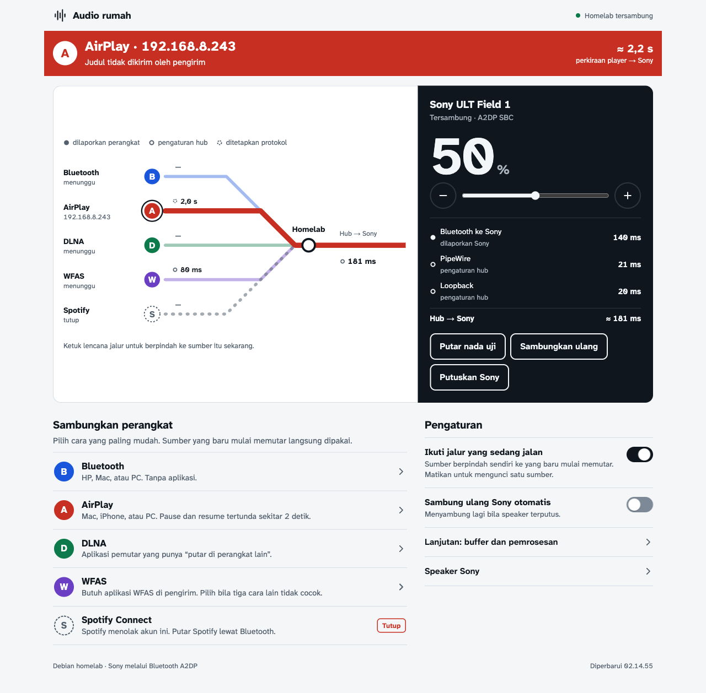
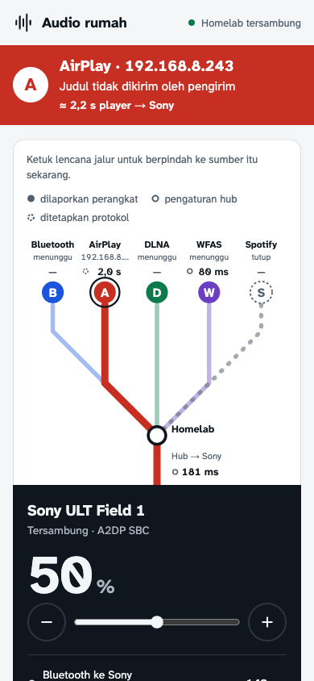
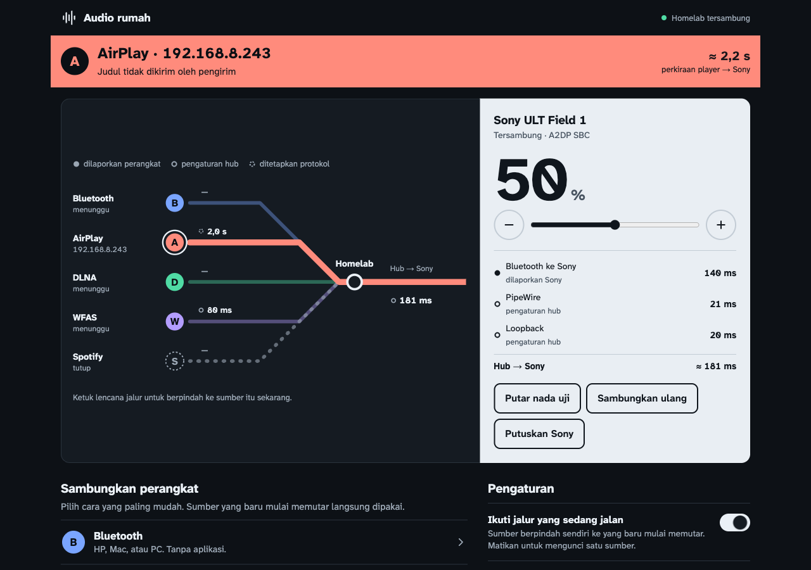
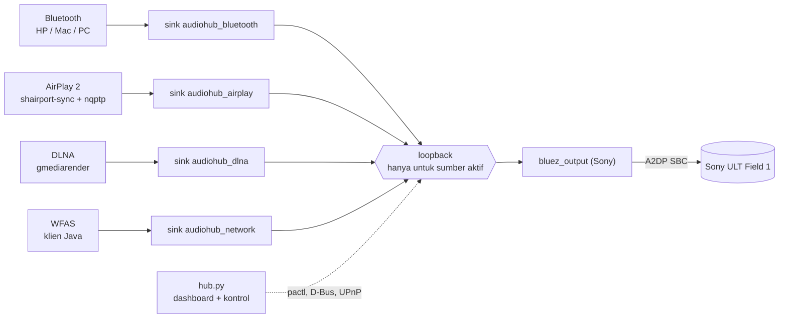
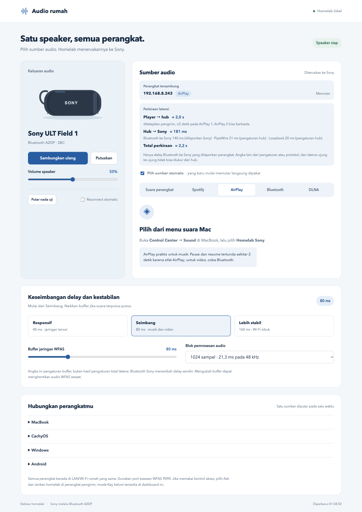

# Audio rumah

**Satu speaker, semua perangkat.** Hub audio homelab yang menerima suara dari HP, Mac, dan PC lewat Bluetooth, AirPlay 2, DLNA, atau WFAS, lalu meneruskannya ke satu speaker **Sony ULT Field 1** lewat Bluetooth A2DP. Dikendalikan dari dashboard web yang menampilkan apa yang sedang memutar, lewat jalur mana, dan berapa latensinya.

<p align="center">
  
</p>

<table>
  <tr>
    <td align="center"><br><sub>Ponsel: status, peta, dan volume di layar pertama</sub></td>
    <td align="center"><br><sub>Mode gelap otomatis mengikuti perangkat</sub></td>
  </tr>
</table>

> Tangkapan layar diambil dari hub yang berjalan; alamat IP di dalamnya adalah alamat LAN privat.

## Isi

- [Fitur](#fitur)
- [Cara kerja](#cara-kerja)
- [Dashboard](#dashboard)
- [Instalasi](#instalasi)
- [Konfigurasi](#konfigurasi)
- [API](#api)
- [Pengembangan](#pengembangan)
- [Keamanan](#keamanan)
- [Batasan yang diketahui](#batasan-yang-diketahui)
- [Pihak ketiga](#pihak-ketiga)

## Fitur

### Lima jalur masuk

| Jalur | Dari | Perlu aplikasi? | Judul lagu | Catatan |
|---|---|---|---|---|
| **Bluetooth** | HP, Mac, PC | Tidak | Bila perangkat mengirimnya (AVRCP) | Tanpa jeda 2 detik; ada dua lompatan Bluetooth. Pairing dari dashboard |
| **AirPlay 2** | Mac, iPhone, PC | Tidak | Dari perangkat Apple; PC Linux tidak mengirim | Dari Safari, pause dan resume instan. Dari Control Center (suara sistem), tertunda sekitar 2 detik (sifat AirPlay) |
| **DLNA** | VLC, BubbleUPnP, Jellyfin | Aplikasi pemutar | Bila pengendali mengirim metadata | Memutar berkas atau tautan media, bukan seluruh suara perangkat |
| **WFAS** | Pengirim WFAS | Ya (WFAS) | Tidak ada | Jalur paling akhir bila tiga lainnya tidak cocok |
| **Spotify Connect** | Aplikasi Spotify | Tidak | - | **Tidak berfungsi** untuk akun ini (lihat [batasan](#batasan-yang-diketahui)) |

### Yang dilakukan hub
- **Sumber otomatis.** Sumber yang baru mulai memutar langsung dipakai; tidak perlu memilih di dashboard. Bisa dikunci lewat saklar "Ikuti jalur yang sedang jalan".
- **Sony dibiarkan tidur.** Jalur ke speaker hanya dibuka selama ada suara (ditambah jeda 90 detik), sehingga A2DP bebas dan Sony bisa istirahat.
- **Perangkat tersambung dan judul lagu** ditampilkan bersama jenis koneksinya.
- **Latensi per ruas dengan asal angkanya:** dilaporkan perangkat, pengaturan hub, atau ditetapkan protokol. Latensi ujung ke ujung tidak bisa diukur dari hub karena berakhir di speaker, dan dashboard tidak berpura-pura bisa. Angka AirPlay ditampilkan sebagai batas atas (`≤ 2,0 s`) karena pengirim yang menentukan: dari Safari hampir instan, dari Control Center sampai sekitar 2 detik.
- **Pairing Bluetooth dari dashboard** (jendela 120 detik, perangkat baru otomatis dipercaya) dan hapus perangkat.
- **Reconnect Sony** tidak memblokir dashboard dan memakai backoff 20 sampai 300 detik.

## Cara kerja



- **Sesi PipeWire terpisah** milik user sistem `audiohub` (`audiohub-engine`). Tidak bercampur dengan audio desktop.
- **Satu sink virtual per sumber.** Layanan sumber (shairport-sync, gmediarender, WFAS, go-librespot) menulis ke sink-nya sendiri. Stream Bluetooth dari HP dipindahkan ke `audiohub_bluetooth`; sink Bluetooth dan DLNA dibuat saat hub berjalan, tanpa restart PipeWire.
- **Satu `module-loopback`** menghubungkan sumber aktif ke sink Sony. Hub memasang dan melepasnya.
- **Aktivitas dibaca dari stream**, bukan dari status sink: stream yang tidak `corked` (dan untuk DLNA, `TransportState = PLAYING`). Status sink saja menyesatkan, karena sink yang monitornya dibaca tetap `RUNNING`.
- **Aturan pergantian:** sumber yang baru mulai memutar mengambil alih; bila tidak ada yang baru, sumber terpilih bertahan selama masih memutar; bila diam, hub mengikuti yang sedang memutar.
- **Berbasis kejadian:** `pactl subscribe` memicu pengecekan dalam sekitar 0,25 detik, dengan polling 3 detik sebagai jaring pengaman.

### Layanan

| Unit systemd | Peran | Port |
|---|---|---|
| `audiohub-engine` | PipeWire, WirePlumber, pipewire-pulse (sesi terpisah) | - |
| `audiohub-dashboard` | `hub.py`: dashboard dan kontrol | TCP 8096 |
| `audiohub-airplay2` + `nqptp` | AirPlay 2 (shairport-sync 5.6.2) dan sinkronisasi waktu PTP | TCP 7000, UDP 319/320 |
| `audiohub-airplay` | AirPlay klasik (cadangan; saling `Conflicts=` dengan `airplay2`) | TCP 5000 |
| `audiohub-dlna` | gmediarender, "Homelab Audio" | TCP 49494, SSDP 1900 |
| `audiohub-spotify` | go-librespot (sudah tidak berguna untuk akun ini) | 127.0.0.1:3678 |

> Status unit saat ini: AirPlay 2 (`audiohub-airplay2` dan `nqptp`) aktif saat boot; `audiohub-airplay` dinonaktifkan dan menjadi cadangan (`sudo systemctl start audiohub-airplay` menggantikan AirPlay 2 untuk sementara karena `Conflicts=`). Pilihan ini diambil karena AirPlay dari Safari terasa instan saat pause. Untuk beralih permanen di mesin lain: `sudo systemctl disable audiohub-airplay && sudo systemctl enable audiohub-airplay2 nqptp`.

## Dashboard

Dirancang sebagai **peta jalur** ala diagram KRL/MRT. Setiap cara menyambung adalah jalur berwarna dengan lencana huruf, semuanya bertemu di satu stasiun (*Homelab*) dan berakhir di satu terminal (*Sony*).

- **Pita status** di atas berwarna sesuai jalur yang sedang memutar: sumber, perangkat, judul, total latensi.
- **Peta jalur** menunjukkan perangkat per jalur dan latensi "player → hub". Jalur yang tidak berfungsi (Spotify) tetap digambar, putus-putus, dan bertanda **Tutup**. Ketuk lencana untuk berpindah sumber.
- **Panel Sony** menampilkan volume sebagai angka besar, rincian latensi "hub → Sony", dan tombol nada uji dan putuskan.
- **Sambungkan perangkat** berisi cara menyambung tiap jalur, termasuk pairing Bluetooth dan daftar pengirim WFAS.
- **Pengaturan:** sumber otomatis, sambung ulang Sony, serta buffer dan blok pemrosesan (dilipat).

Keputusan desain dan alasannya ada di [`docs/design/PRODUCT.md`](docs/design/PRODUCT.md), dan mockup interaktif yang disetujui di [`docs/design/mockup.html`](docs/design/mockup.html) (buka di browser; ada tombol untuk mengganti keadaan contoh).

<details>
<summary>Dashboard sebelum desain ulang</summary>



Masalahnya: tab dipakai untuk dua hal (memilih sumber dan petunjuk menyambung), panel speaker setengah kosong, volume terdorong ke bawah di ponsel, dan petunjuk WFAS mendominasi padahal itu jalur yang paling tidak dipakai.
</details>

## Instalasi

> Ini rekonstruksi dari sistem yang berjalan. **Belum diuji pada mesin bersih.** Berkas referensi ada di [`deploy/`](deploy/); nilai khusus jaringan perlu disesuaikan (lihat tabel di bawah).

**Prasyarat** (Debian 13 "trixie"): PipeWire 1.4, WirePlumber 0.5, BlueZ 5.82, Python 3.11+ (dikembangkan di 3.13), dan adapter Bluetooth yang mendukung A2DP sebagai sumber maupun penerima.

```bash
# runtime
sudo apt install pipewire pipewire-pulse wireplumber bluez pulseaudio-utils \
  python3-aiohttp python3-dbus shairport-sync \
  gmediarender gstreamer1.0-plugins-base gstreamer1.0-plugins-good \
  gstreamer1.0-plugins-ugly gstreamer1.0-libav gstreamer1.0-pulseaudio

# user dan direktori
sudo useradd --system --create-home --home-dir /var/lib/audiohub --groups audio,bluetooth audiohub
sudo mkdir -p /opt/homelab-audiohub && sudo chown "$USER" /opt/homelab-audiohub
git clone <repo> /opt/homelab-audiohub        # atau salin berkasnya

# konfigurasi sesi PipeWire milik audiohub
sudo -u audiohub mkdir -p /var/lib/audiohub/.config/{pipewire/pipewire.conf.d,pipewire/pipewire-pulse.conf.d,wireplumber/wireplumber.conf.d}
sudo cp deploy/pipewire/pipewire.conf.d/*            /var/lib/audiohub/.config/pipewire/pipewire.conf.d/
sudo cp deploy/pipewire/pipewire-pulse.conf.d/*      /var/lib/audiohub/.config/pipewire/pipewire-pulse.conf.d/
sudo cp deploy/wireplumber/wireplumber.conf.d/*      /var/lib/audiohub/.config/wireplumber/wireplumber.conf.d/
sudo chown -R audiohub: /var/lib/audiohub/.config

# unit
sudo cp deploy/systemd/*.service /etc/systemd/system/ && sudo systemctl daemon-reload
sudo systemctl enable --now audiohub-engine audiohub-dashboard audiohub-airplay audiohub-dlna
```

Setelah itu pairing Sony sekali (dashboard, **Pengaturan → Speaker Sony → Pairing ulang**), dengan mode pairing di speaker menyala.

### Komponen yang dibangun atau diunduh sendiri (tidak ada di repositori)

| Komponen | Letak | Catatan |
|---|---|---|
| **shairport-sync 5.6.2** (AirPlay 2) dan **nqptp 1.2.9** | `vendor/ap2/`, `/usr/local/bin/nqptp` | Dibangun dari tag resmi. `configure`: `--prefix=/opt/homelab-audiohub/vendor/ap2 --sysconfdir=.../ap2/etc --with-airplay-2 --with-pulseaudio --with-avahi --with-ssl=openssl --with-soxr --with-ffmpeg --with-metadata`. Butuh `libplist-utils`, `libplist-dev`, `libsodium-dev`, `libgcrypt20-dev`, `libavcodec-dev`, `libavformat-dev`, `libavutil-dev`, `libswresample-dev`, `libsoxr-dev`, `libavahi-client-dev`, `libpulse-dev`, `libssl-dev`, `uuid-dev`, `xxd` |
| **go-librespot 0.10.5** | `vendor/go-librespot` | Hanya untuk Spotify Connect |
| **WFAS** (aplikasi Java) | `vendor/wfas/` | Hanya bila memakai jalur WFAS |

### Nilai yang perlu disesuaikan

| Nilai | Letak |
|---|---|
| MAC speaker (`SONY`) | `core.py` |
| Jaringan `192.168.8.0/24` dan daftar IP yang ditolak untuk pengirim WFAS | `core.py` (`clean_ip`) |
| IP hub `192.168.8.240` (kontrol DLNA, host yang diizinkan, antarmuka multicast WFAS) | `hub.py` |
| Nama host `audio.home.arpa` pada daftar host yang diizinkan | `hub.py` |
| `AUDIOHUB_BIND`, `AUDIOHUB_PORT`, `AUDIOHUB_STATE` | `deploy/systemd/audiohub-dashboard.service` |
| Antarmuka jaringan (`-I enx...`) dan UUID perangkat DLNA | `deploy/systemd/audiohub-dlna.service` |
| Antarmuka yang diiklankan Spotify | `deploy/spotify/config.yml` |

## Konfigurasi

Pengaturan disimpan di `AUDIOHUB_STATE` (bawaan `/var/lib/audiohub/settings.json`, mode 0600, ditulis atomik) dan diubah lewat dashboard atau `POST /api/settings`.

| Kunci | Nilai | Bawaan | Arti |
|---|---|---|---|
| `source` | `bluetooth`, `airplay`, `dlna`, `spotify`, `network` | `network` | Sumber terpilih |
| `auto_source` | boolean | `true` | Ikuti sumber yang baru mulai memutar |
| `volume` | 0 sampai 100 | `30` | Volume sink Sony |
| `speaker_enabled` | boolean | `true` | `false` setelah Anda memutus Sony secara manual |
| `auto_reconnect` | boolean | `true` | Sambung ulang Sony otomatis |
| `network_enabled` | boolean | `false` | Dengarkan pengirim WFAS di `sender_ip` |
| `sender_ip` | IPv4 di LAN | kosong | Alamat pengirim WFAS |
| `buffer_ms` | 20 sampai 250 | `80` | Buffer WFAS |
| `quantum` | 256, 512, 1024, 2048 | `1024` | Blok pemrosesan PipeWire (sampel pada 48 kHz) |

## API

Semua respons JSON. `GET /api/status` mengembalikan `token`; setiap `POST` harus menyertakannya di header `X-AudioHub-Token`.

| Metode dan jalur | Fungsi |
|---|---|
| `GET /api/status` | Seluruh keadaan: `settings`, `speaker`, `connections`, `now_playing`, `latency`, `playing`, `bluetooth_in`, `receiver`, `peers`, `route_active`, `error`, `token` |
| `POST /api/settings` | Ubah sebagian pengaturan (kunci di atas) |
| `POST /api/speaker/{connect,disconnect,pair,test}` | Kontrol Sony |
| `POST /api/bluetooth/{pair,cancel}` | Buka atau tutup jendela pairing 120 detik |
| `POST /api/bluetooth/forget` | Hapus perangkat; body `{"address": "AA:BB:..."}` |
| `GET /api/spotify` | Status go-librespot (tanpa kredensial) |

## Pengembangan

```
core.py          logika murni: validasi pengaturan, parser, laporan latensi (tanpa I/O)
hub.py           pengendali asyncio: PipeWire (pactl), BlueZ (D-Bus), UPnP, API aiohttp
static/          dashboard (index.html, app.js, style.css, fonts/)
test_core.py     tes logika murni
test_api.py      tes pengendali dengan pactl/D-Bus/bluetoothctl tiruan
deploy/          salinan referensi unit systemd dan konfigurasi
docs/            tangkapan layar dan catatan desain
shairport*.conf  konfigurasi AirPlay klasik dan AirPlay 2
engine.sh        menjalankan PipeWire, WirePlumber, pipewire-pulse
```

```bash
python3 -m unittest test_core test_api     # 87 tes; butuh Python 3.11+ (loop.sock_sendto)
```

- **Tes lebih dulu** untuk logika baru; logika yang bisa murni diletakkan di `core.py`.
- **Dashboard tidak punya tes otomatis.** Verifikasinya manual di browser terhadap hub yang berjalan.
- **CSP ketat** (`default-src 'self'`): tanpa skrip atau gaya inline, tanpa font atau stylesheet eksternal. Atribut `style` tidak boleh ada di markup; gaya dinamis lewat kelas atau CSSOM. Data dari perangkat lain yang masuk ke SVG harus di-escape.
- **Deploy:** salin berkas ke `/opt/homelab-audiohub`, lalu `sudo systemctl restart audiohub-dashboard` (hanya perlu bila `*.py` berubah; berkas `static/` langsung terlayani). AirPlay tidak ikut terputus.
- **Git:** repositori lokal (cabang `main`, belum ada remote). Commit pertama adalah kondisi awal sebelum semua perubahan.

## Keamanan

Dirancang untuk **LAN rumah yang dipercaya**, tanpa login.

- Token CSRF dan pengecekan `Origin` melindungi dari halaman web yang memicu perubahan, serta pengecekan `Host` dari DNS rebinding. Keduanya **bukan autentikasi**: perangkat mana pun di LAN bisa mengambil token lewat `GET /api/status` dan mengendalikan hub.
- Hanya IP di jaringan lokal (dan bukan gateway atau hub sendiri) yang diterima sebagai pengirim WFAS.
- Semua layanan berjalan sebagai user `audiohub` dengan `NoNewPrivileges`, `UMask=0077`, dan batas memori.
- Jendela pairing Bluetooth dibuka manual, berlangsung 120 detik, lalu menutup sendiri.
- Token dibuat ulang setiap hub dimulai.

## Batasan yang diketahui

- **Spotify Connect ditolak server Spotify** untuk akun ini (`failed retrieving aes key with code 1`). Penyebabnya batasan di sisi Spotify (akun yang dipaksa memakai DRM PlayPlay), bukan bug hub; go-librespot sudah versi terbaru. Gunakan Spotify lewat Bluetooth.
- **AirPlay:** dari Control Center (suara sistem) pause dan resume tertunda sekitar 2 detik; dari Safari instan (pengamatan pemilik, belum diukur). PC Linux lewat AirPlay tidak mengirim judul lagu.
- **Latensi ujung ke ujung tidak terukur.** Hanya delay Bluetooth Sony yang dilaporkan perangkat; angka lain adalah pengaturan atau angka protokol.
- **Satu adapter Bluetooth** dipakai untuk Sony dan perangkat masuk. Pemindaian terus-menerus oleh integrasi Bluetooth lain di host yang sama (misalnya Home Assistant) bisa membuat koneksi putus-putus.
- **Satu perangkat Bluetooth** yang praktis dipakai pada satu waktu.
- **Sesi AirPlay 2 yang terbuka tapi senyap** dianggap aktif, sehingga menahan Sony tetap menyala sampai sesi ditutup.
- **DLNA** tidak tahu perangkat pengendalinya, sehingga namanya tampil umum.
- Nilai khusus jaringan tertanam di kode (lihat [tabel](#nilai-yang-perlu-disesuaikan)).

## Pihak ketiga

PipeWire, WirePlumber, BlueZ, [shairport-sync](https://github.com/mikebrady/shairport-sync), [nqptp](https://github.com/mikebrady/nqptp), [gmediarender](https://github.com/hzeller/gmrender-resurrect), [go-librespot](https://github.com/devgianlu/go-librespot), dan WFAS ([WiFiAudioStreaming](https://github.com/marcomorosi06/WiFiAudioStreaming-Desktop)). Masing-masing punya lisensi sendiri; periksa di repositori asalnya.

Font [Atkinson Hyperlegible Next](https://fonts.google.com/specimen/Atkinson+Hyperlegible+Next) memakai SIL Open Font License 1.1 (lihat `static/fonts/README.txt`).

Lisensi untuk kode di repositori ini **belum ditentukan**.
